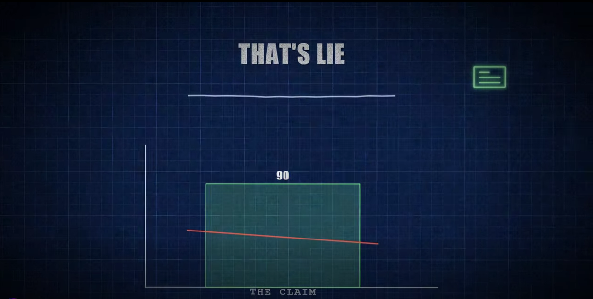
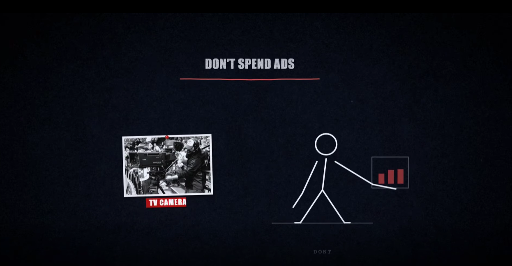
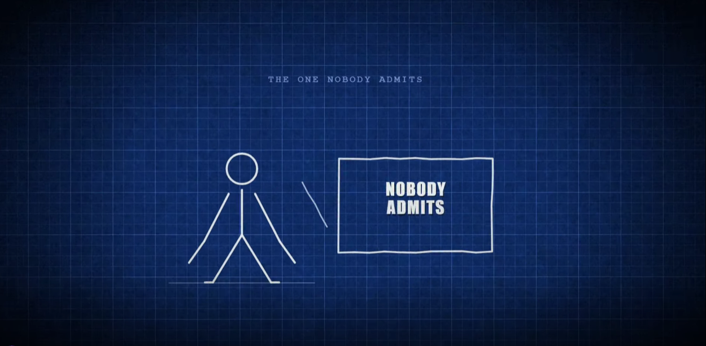

# Automatic Storyteller Animate 🎬✨

[](LICENSE)
[](https://www.python.org/downloads/)
[](https://ffmpeg.org/)

Turn a single **voiceover file** and a **script** into a fully finished, cinematic, narrated explainer film automatically. No manual storyboarding, no manual scene layout, no tedious video timeline editing.

---

## 🌟 Highlights & Visual Style

The engine alternates between two distinct visual languages every 3–10 seconds:

1. **Blueprint Board**:
   - Dark blue textured blueprint grid.
   - Hand-drawn chalk typography, sketch-rect callout boxes, wobbly lines, scribble terminal code windows, and chalk checkmarks.
   - Procedural **neon icons** rendered with dual-pass glow and white-hot cores.
2. **Evidence Wall**:
   - Dark investigative evidence board.
   - Pinned real Wikimedia Commons photos with dynamic drop shadows and pushpins.
   - Typeset paper documents, highlight strips, and glowing accents.

### 📸 Visual Output Examples

| Blueprint Whiteboard & Specimen Cards | Hand-Drawn Bar Chart & Claim Strikeout |
| :---: | :---: |
|  |  |

| Dark Evidence Wall + Stickman + Photo Card | Blueprint Whiteboard + Chalk Stickman |
| :---: | :---: |
|  |  |

### Built-in Production Features:
- 🎙️ **Precise Word-Level Alignment**: Uses `faster-whisper` for word-accurate alignment.
- 💬 **Dynamic Bottom-Flush Neon Captions**: Eased kinetic entrance/exit animations with a rainbow sweep on active spoken words.
- 🔊 **Automated Sound Design**: Word-synchronized synthesized sound effects bus (-19 dB) ducked against a CC-licensed background music bed (-18 dB), mastered to broadcast standard **-15 LUFS / -1.5 dBTP**.
- 🛡️ **Automated QA Gate**: Verifies video frame counts, audio loudness specs, caption visibility, and margin bounds before finalizing.

---

## 🚀 Quick Start

### 1. Requirements

- **Python 3.8+**
- **FFmpeg & FFprobe** on your system PATH
- Sibling engine: **`cinematic-film`** (installed beside this skill or set via `CINEMATIC_SCRIPTS`)

### 2. Install Dependencies

```bash
pip install -r requirements.txt
```

*(Packages: `numpy`, `skia-python`, `Pillow`, `faster-whisper`)*

### 3. Generate a Film

Place your narration audio (`voice.mp3` or `.wav`) and your script file (`script.md` or `.txt`), then run:

```bash
python scripts/run.py --project my-film --voice voice.mp3 --script script.md
```

#### Fast Preview (Render 2 blocks at 360p):
```bash
python scripts/run.py --project my-film --voice voice.mp3 --script script.md --preview
```

---

## ⚙️ CLI Options

| Flag | Description | Default |
|---|---|---|
| `--project` | Name/path of the output project folder | *Required* |
| `--voice` | Path to narration audio file | *Required* |
| `--script` | Path to markdown, text, or SRT script | *Required* |
| `--size` | Target video resolution (`WIDTHxHEIGHT`) | `1920x1080` |
| `--crf` | H.264 compression CRF (lower = higher quality) | `16` |
| `--photos` | Photo retrieval mode (`auto`, `existing`, `none`) | `auto` |
| `--music` | Soundtrack mode (`auto`, `none`, or path to `.mp3`) | `auto` |
| `--model` | faster-whisper model (`tiny.en`, `base.en`, `small.en`) | `tiny.en` |
| `--workers` | Parallel rendering worker threads (0 = all cores - 1) | `0` |
| `--preview` | Quick low-res preview of the opening blocks | `False` |
| `--force` | Force complete rebuild ignoring cache | `False` |

---

## 📁 Output Artifacts

Running the pipeline produces:

```text
my-film/
├── audio/
│   ├── narration.m4a       # Normalized audio
│   └── timing.json          # Line & word timestamps
├── beats.json               # Director plan & layout assignments
├── beats.md                 # Human-readable timeline breakdown
├── credits.md               # Auto-attributed media licenses
├── out/
│   ├── blocks/              # Rendered individual scene clips
│   ├── silent.mp4           # Assembled visual track
│   ├── captioned.mp4        # Video with burned-in dynamic captions
│   ├── FILM.mp4             # Final mastered film with full audio mix
│   ├── FILM.srt             # Subtitle file
│   └── qa/                  # Visual QA verification snapshots
```

---

## 🧩 OpenCode / Claude Agent Skill Integration

This repository is structured as an agent skill. You can drop this directory directly into your agent's skills directory (`.opencode/skills/` or `.claude/skills/`) to allow your coding agent harness to generate explainer films autonomously on prompt.

---

## 📄 License

This project is licensed under the [MIT License](LICENSE).
Background music *Crypto* by Kevin MacLeod is licensed under [CC BY 4.0](https://creativecommons.org/licenses/by/4.0/).
